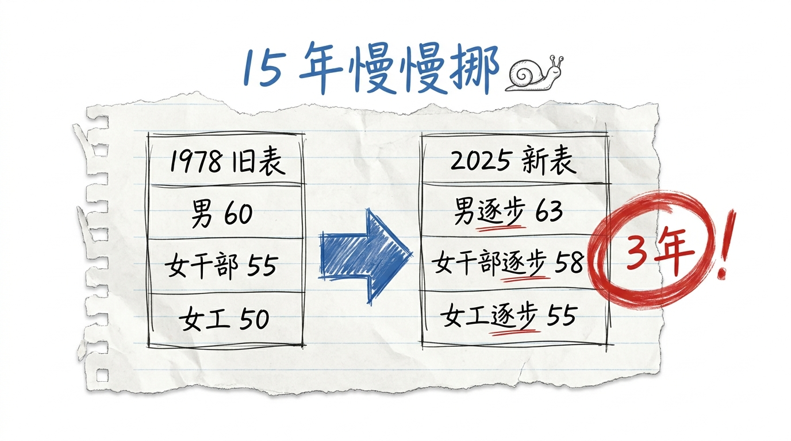
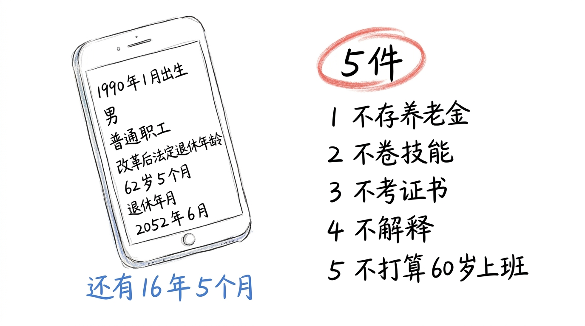

# 延迟退休到 63 了, 我学会了不为 60 岁攒

9 月 14 日, 周一, 阴。

我打开 12333 的"法定退休年龄计算器", 填了 1990 年 1 月, 男, 普通职工。 系统弹出来:

> 改革后法定退休年龄: 62 岁 5 个月  
> 退休年月: 2052 年 6 月  
> 可弹性选择区间: 59 岁 5 个月 — 65 岁 5 个月

我 36 岁。 还有 16 年 5 个月。

不是 27 年, 是 16 年。 我之前算错了。

## 你从哪天开始算的?

9 月 10 日, 腾讯新闻发了《延迟退休后, 你到底哪年退休? 30 秒查清》。 9 月 9 日, 临沂日报发了《这三类人员不允许弹性延迟退休》。 9 月 8 日, "自渡" 成了 9 月年轻人搜索量最高的词。

3 个新闻, 同根: **我们这代人, 退休这件事, 变了**。

我以前以为: 退休 = 60 岁 = 攒钱 25 年 = 月薪 1 万 + 存款 300 万 + 提前 5 年辞职环游世界。

9/14 之后, 我知道: 反的。 退休不是 60 岁, 是 62 岁 5 个月, 提前最早 59 岁 5 个月, 弹性延后最晚 65 岁 5 个月。 整段区间 6 年, 不是 1 个点。

我以为攒钱 25 年, 实际是 26 年 5 个月。 我以为提前 5 年退休, 实际最早 2 年 5 个月。 我以为 60 岁就是终点, 实际是"被退休还是自己退" 的分叉。

## 12333 算完, 我"不焦虑" 了 5 件事

算完, 我列了 1 张清单: **5 件我决定不为 60 岁攒的事**。

不是"我学会了攒" (那是 020/021 时代的逻辑, 现在还这么说就假了), 是"我学会了不为 60 岁攒"。

1. **不存养老金第二支柱**。 商业养老保险, 每年 1 万, 20 年交 20 万, 月领 2000。 2000 块不够杭州 1 间房租, 我干嘛要给 1 个"我可能 65 岁才用" 的产品交钱?
2. **不卷新技能为了"60 岁还能干"**。 Python / 数据分析 / AI 提示词, 我学是因为好玩, 不是为了"60 岁不被淘汰"。 60 岁我都不想上班了, 我卷它干嘛?
3. **不考"60 岁能用" 的证书**。 中级经济师 / PMP。 1 张证书 1 年的复习时间, 1 年之后又能用上几次?
4. **不跟亲戚解释我"不攒"**。 春节聚会, 亲戚问"你养老金交了没", 我说"我决定不为 60 岁攒", 他们笑我"不上进"。 我学会了不解释, 笑就笑。
5. **不打算 60 岁还"正常工作"**。 60 岁之后, 我不打算继续上班 (除非迫不得已), 我打算写东西 / 摆拼豆 / 钩织 (跟 027 一样, 不为出精品, 是手搓)。

## 5 件, 不是清单, 是"我不为这个攒" 的清单

这 5 件, 不是我"想清楚" 的, 是我"算完 12333 算清楚" 的。

延迟退休前, 我以为 60 岁退休, 攒 25 年, 月薪 1 万 + 存款 300 万 + 提前辞职 = 退休 = 自由。

延迟退休后, 我知道: **65 岁退休 (弹性延后), 攒 30 年, 月薪 1 万 + 存款 300 万 + 提前辞职 = 退休 = 自由**? 不, 提前最早 59 岁 5 个月, 不存在"提前 5 年" 这个选项。 你要么 59.5 退, 要么 60 退, 要么 62 退, 要么 65 退。 没 60 退 + 攒 25 年 = 自由这个公式。

公式破了, 攒钱的"目标" 也破了。

我以前攒钱是为了"60 岁退休"。 现在没有"60 岁退休" 这个目标, 攒钱变成 1 个**没有目标的过程**。

## 延迟退休 = 草稿的另一种说法

公众号 9 月三联, 026「自渡」+ 027「手搓」+ 028「AI 税」, 3 篇都收在"草稿"。 029 是第 4 篇, 4 篇都收在"草稿", 这次是时间维度。

026 告诉你, 没人会来救你。 027 告诉你, 造船不用等到完美。 028 告诉你, 你以为你在买船, 其实你在为造船用的钉子付钱。

029 告诉你: **你以为你在攒船, 其实你在为 1 个"还要等 16 年" 的船坞攒钱**。

攒 16 年, 不是为"船" (退休), 是为"船坞" (延迟退休这个新规则)。 你买的是"还在建" 的过程, 不是"建好" 的作品。

**你永远在为草稿攒钱, 不为作品攒钱**。

公众号角度: 延迟退休 = 草稿的另一种说法。

不是"我反对延迟退休" (那是政策讨论, 不是我这种公众号该聊的), 也不是"我教你怎么理财" (那是理财博主的活)。 我只是看清楚: **我在为 1 个 16 年后的"还在变" 攒, 攒的过程比攒的结果重要**。

## 收尾

公众号 9 月四联, 026「自渡」+ 027「手搓」+ 028「AI 税」+ 029「延迟退休」。

026 心理, 027 行为, 028 工具, 029 时间。 4 个维度, 都收在"草稿"。

4 篇, 都落在同一句话: **你学会的, 跟你攒的, 跟你做出来的, 跟你等到的, 不是同义词**。

> 延迟退休到 63 了, 我学会了不为 60 岁攒。 你为 60 岁攒, 你在为 1 个"还在变" 的目标攒。 攒 16 年, 不是为船, 是为船坞。 延迟退休 = 草稿的另一种说法。
