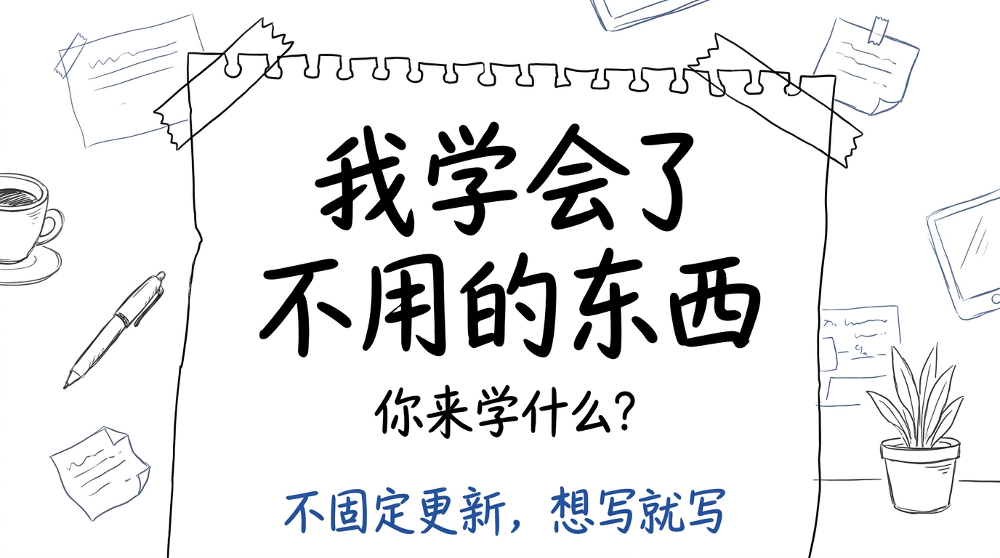
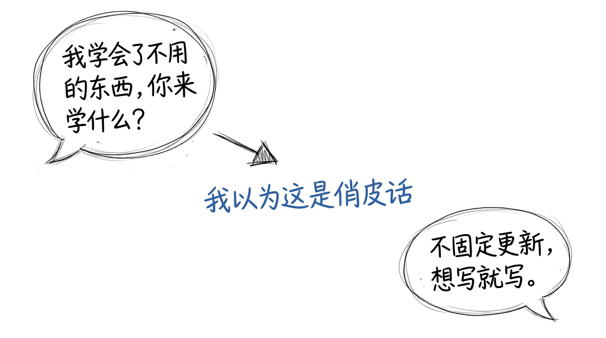
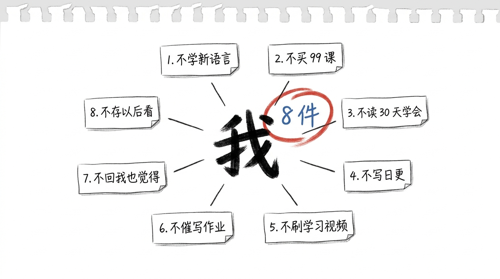
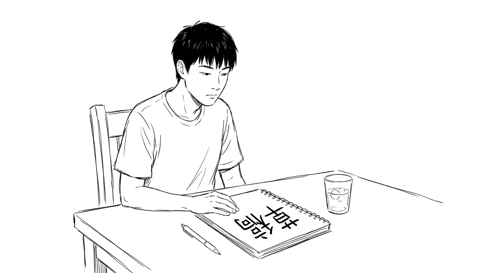
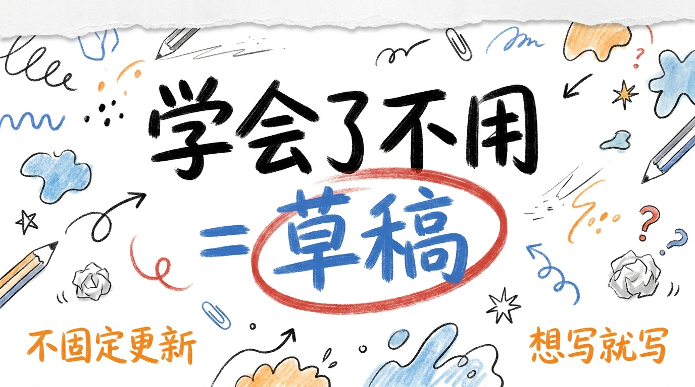

# 我学会了不用的 8 个东西, 你来学什么?

公众号简介, 我自己写的:

> 我学会了不用的东西, 你来学什么?  
> 不固定更新, 想写就写。

写的时候, 我以为这是一句俏皮话。

写公众号 1 年半 (从 025 那篇"3:15 醒来" 倒推, 实际是 2025 年 1 月到现在, 共 29 篇), 我才发现: 简介是真的, 我真的学会了一堆"不用的东西"。

## 简介不是俏皮话, 是清单

简介写的 2 句, 第 1 句是问, 第 2 句是答。

我以为第 1 句"你学什么" 是个反问, 没答案。 9/14 整理草稿箱, 我数了一下, 我自己学会了 8 个"不用的东西"。

不是 8 个"我想学但没学", 是 8 个"我学过, 学会了, 然后决定不用了"。

## 8 个我学会"不用的东西"

1. **不学新编程语言为了跳槽**。 Python / Go / Rust, 0 基础到能写项目, 1 年半。 我学会了 1 次 (Python, 3 年前), 后来发现"为了跳槽" 是个伪需求 — 我 3 年没跳过槽, 学的语言也没用上。

2. **不买 99 块的网课**。 写作课 / 短视频课 / 公众号运营课 / AI 提示词课。 1 年下来, 4 门课 4 个 99, 共 396 块, 看完 1.5 门。 1.5 门 = 150 块的"学到", 剩下 246 块 = "学不到"。 我学会了不买。

3. **不读"30 天学会 X" 类的书**。 30 天学会 Python / 30 天学会写作 / 30 天学会时间管理。 1 个月 1 本, 1 年 12 本, 10 年 120 本, 我读了 7 本 (中间放弃的没算), 没 1 本让我"学会"。 我学会了不读。

4. **不写公众号日更**。 简介写的"不固定更新, 想写就写", 之前我以为是"懒", 后来发现是"草稿"。 1 周 1 篇 + 中间 2-3 周空档, 比 1 天 1 篇 + 30 天后放弃 强 100 倍。 我学会了不日更。

5. **不刷短视频"学习"**。 抖音 / 小红书 / 视频号上"30 秒教你 X" 的视频, 1 天刷 50 条, 0 条让我"学完"。 50 条 = 25 分钟, 25 分钟 = 1 集剧, 1 集剧至少能记住 1 个情节。 我学会了不刷"学习视频"。

6. **不催孩子写作业**。 每天 6 点回家, 孩子 7 点写完, 1 小时。 我以前 5 点半开始催"今天作业多吗? 难吗? 写了吗?"。 催完孩子, 我自己也没休息, 1 小时零收益。 我学会了不催, 1 句话不说, 7 点他自己写完。

7. **不在群里回复"我也觉得"**。 工作群 / 家人群 / 同学群, 每天 200 条消息, 我回 30 条"我也觉得" / "是的" / "+1" / "👍"。 30 条 0 价值。 我学会了不回。

8. **不存"以后看"**。 微信收藏 / 微博收藏 / 抖音收藏 / 小红书收藏, 1 年下来 2000+ 条。 "以后看" 1 条没看。 我学会了不存 — 看到的当下看完, 看不完就跳过。

## 8 件, 不是 8 个"放弃", 是 8 个"我有了选择权"

我以前以为"不用的东西" = "我放弃了什么" = "我输了"。

9/14 整理的时候, 我发现: 不是。 **"不用的东西" = "我学完了, 然后决定不用" = "我有了选择权"**。

我学会了 Python, 然后决定不为跳槽用。 学会了之后不用, 跟没学过的区别是: 看到别人说"Python 必学", 我能判断"我不需要"。 没用过的人只能焦虑。

我学会了不写日更, 然后决定想写就写。 学会了之后不用, 跟没学过的区别是: 看到别人说"日更是基本功", 我能判断"我不需要"。 没用过的人只能跟着焦虑。

**"学会了不用" 跟"没学" 不是同义词**。 "学会了不用" 是过程, "没学" 是不知道怎么开始。

## 学会了不用 = 草稿的另一种说法

公众号 9 月四联, 026「自渡」+ 027「手搓」+ 028「AI 税」+ 029「延迟退休」, 都收在"草稿"。 030 是第 5 篇, 也是"草稿"。

5 个共同点: **你不需要等"学会了" 才能"不用", 你学完了, 然后决定不用, 这本身就是 1 个过程**。

5 个维度, 都落在同一句话: **你学会的, 跟你攒的, 跟你做出来的, 跟你等到的, 跟你放弃的, 不是同义词**。

## 收尾

公众号简介 2 句, 写的时候是俏皮话, 写 29 篇之后才发现是真的。

> 我学会了不用的东西, 你来学什么?

我现在可以回答: 8 个。

> 不固定更新, 想写就写。

8 个里面的 1 个。

> 学会了不用 = 草稿的另一种说法。 你不需要等"学会了" 才能"不用", 你学完了, 然后决定不用, 这本身就是 1 个过程。
