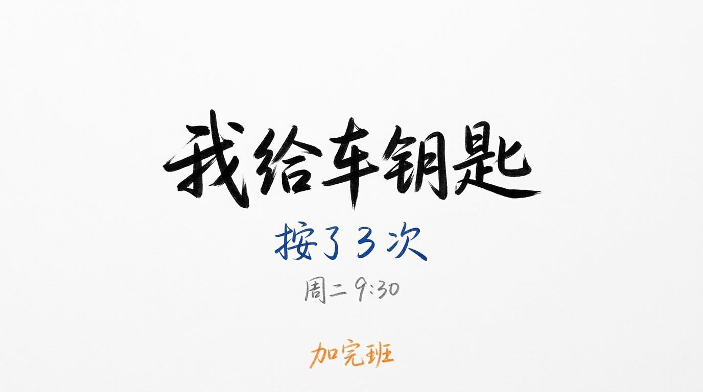
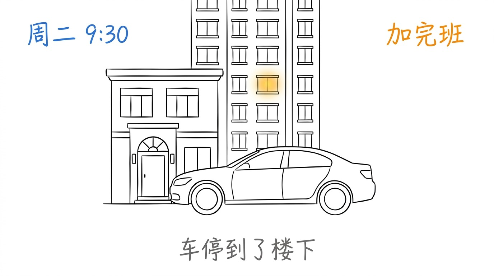
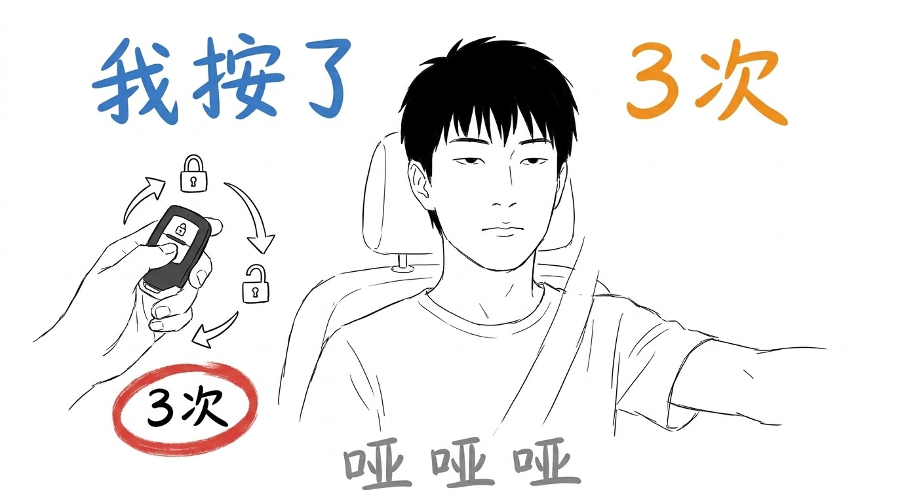
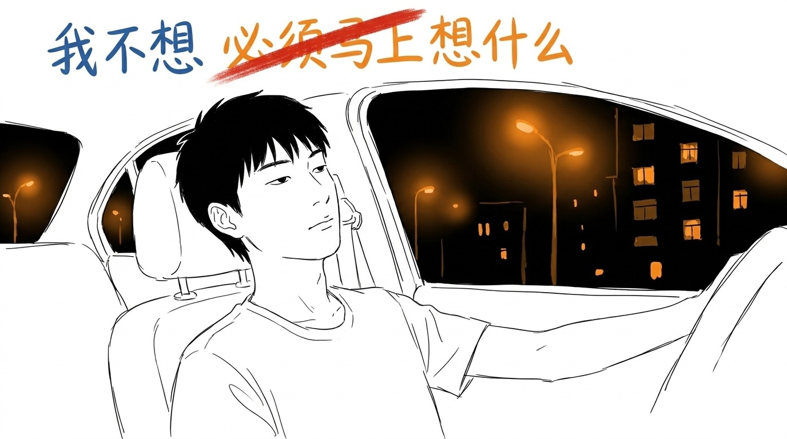
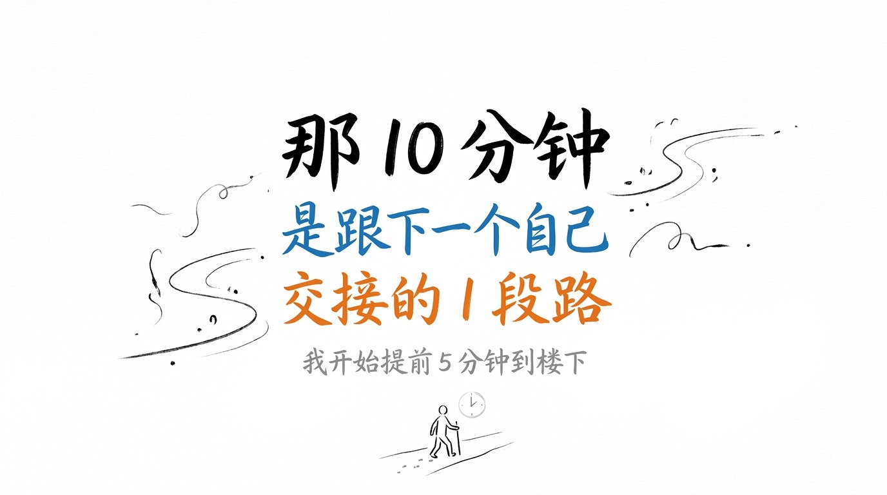

周二晚上 9 点 30 分。 我刚加完班, 车停到了楼下。

我没熄火。 先熄了火。 又没下车。

我从副驾拿水, 没喝, 放回去了。 我拧了一下钥匙, 车"哔"了 1 声, 锁了。 我又拧了一下, "哔哔", 解锁。 我又拧, 锁。 1 把车钥匙, 我按了 3 次。

## 车里闷, 空调嗡嗡响

我坐在驾驶位。 没开窗。 9 月的杭州, 车里有点闷。

我看车窗外面 — 单元楼的灯, 7 楼亮着。 那是我家。 客厅的灯, 没开。

我想到几种解释:

- 我累了。 但我已经加完班了, "累" 这件事已经发生完了, 我不需要再"累" 1 次。
- 我想静静。 但车里没有"静", 只有空调的嗡嗡声。
- 我怕回家。 怕什么呢? 怕孩子问我"爸你今天怎么这么晚"? 怕孩子他妈问我"吃饭了没"? 怕看见儿子的作业还没写完?

我都不是。

我坐在这, 是在做 1 件更难的事: **不想"必须马上想什么"。**

## 我按了 3 次车钥匙

"到家" 这件事是有重量的。

它不是"到 1 个物理空间", 是"切到另 1 个版本的我"。 上楼之前, 我是"下班的我"。 上楼之后, 我是"丈夫/父亲/儿子/晚饭还没吃的我"。

切换这件事, 我不是不会, 我只是需要 1 段缓冲。

10 分钟。 不长。 也不需要长。 5 分钟也行, 15 分钟也行。 不重要。

重要的是: 我"想留多少"。

我按了 3 次车钥匙, 不是在纠结"回不回", 是在给自己留 1 段"我决定什么时候回" 的时间。

## 9 点 40 分, 我按到底了

9 点 40 分。 我看手机。

没有未读。 没有任何东西在催我。

我深吸一口气, 这次按了锁车键, 按到底了。 下车。 关门。 钥匙放口袋。

上楼。 开门。

儿子在客厅写作业, 抬头看我 1 眼: "爸, 你回来了?"

"嗯。"

我进厨房。 孩子他妈在热饭。 "今天加班了?"

"嗯, 加了 1 个小时。"

我坐餐桌。 饭端上来。 我开始吃。

我忽然意识到 1 件事 — 我刚才在车里坐了 10 分钟, 不是在想什么。 那 10 分钟里, 我脑子里是空的。 不是"刻意清空", 是"我还没准备好装新东西"。

车钥匙在我口袋里。 跟进门前的我, 是同 1 把。

但坐在车里那个我, 跟坐在餐桌前的我, 不是同 1 个。

车钥匙那 3 次"哔哔", 是我跟下一个自己交接的 1 段路。

## 提前 5 分钟到楼下

我开始提前 5 分钟到楼下。

不是怕迟到。 是给自己留 10 分钟。

---

# 配图说明 (v2.8.18 防失联 + 单篇独立 + v2.8.17 蹭热点边界)

> **风格**: v2.8.7 抖音视觉延伸公众号版 + warm-ink 4 色 (墨/红/橙/蓝) + 大量留白
> **张数**: 5 张 (1 封面 + 1 场景 + 2 含 IP + 1 punchline)
> **字数**: ~1080 字 (符合 1000-1500 字范围)
> **digest**: 16 字符 ≤ 54 字符 (v2.8.17 硬限制)
> **IP**: 02 + 03 共 2 张小凡 IP (v2.8.18 防失联硬规则: 5 张至少 1 张含 IP, 2 张 IP 占 50%, 远超下限)
> **单篇独立**: 全文不引用历史文章编号/标题/主题 (v2.8.21 硬规则)
> **不蹭热点**: 不蹭具体事件, 永恒场景 (车到楼下)
> **调性**: 死板冷静, 不喊"鸡汤"/"草稿"等主题词, 落到具体物件 (车钥匙) 收尾
> **叙事身份**: 第一人称爸爸 (v2.8.18 性别默认男性)
> **场景**: 9 月杭州 (短袖 t-shirt)
> **品牌**: 无品牌名, 无 logo
> **格式修正 (v2.8.29)**: 修裸 `##` 标题 + 裸 `---` 分隔符 + 正文缺 `` 引用, 共 5 张图全部插入正文 (原 v2.8.28 版裸 `##` 公众号渲染不全)

| 文件 | 内容 | 风格 | 作用 |
|---|---|---|---|
| 00-cover.png | 大字"我给车钥匙" + 蓝字"按了 3 次" + 灰字"周二 9:30" + 橙字"加完班" | 纯白底 + 黑线 + 黑大字 + 蓝小字 + 灰小字 + 橙小字 | 封面, 故事钩子, no IP |
| 01-car-park.png | 1 辆车的剪影 (无品牌, generic outline) 停在小区楼下, 车窗灯光, 单元楼 7 楼亮着 1 盏灯 | 纯白底 + 黑线 + 车剪影 + 小区楼下 + 单元楼灯光 | 场景, no IP |
| 02-keys.png | 小凡手握车钥匙 (车内视角, 短袖T恤, 9 月杭州), 车钥匙上有"锁车/解锁" 2 个按钮 + 红 brush 圈 "3 次" | 纯白底 + 黑线 + 小凡 IP + 车钥匙特写 + 红 brush 圈 | 车钥匙动作, **含小凡 IP** |
| 03-ip-reflection.png | 小凡坐在驾驶位, 头靠头枕, 看车窗外, 车窗外小区灯光 + 红 brush 划掉 "必须马上" | 纯白底 + 黑线 + 小凡 IP + 车内场景 + 车窗外灯光 | 反思, **含小凡 IP** |
| 04-punchline.png | 大字"那 10 分钟" + 蓝字"是跟下一个自己" + 橙字"交接的 1 段路" + 灰字"我开始提前 5 分钟到楼下" | 纯白底 + 黑线 + 黑大字 + 蓝大字 + 橙大字 + 灰小字 | punchline + 物件收尾, no IP |

5 张图里 2 张含 IP (02, 03), 40% 比例, 满足 v2.8.18 硬规则 1 张下限.

**5 段 ## 内容长度不均 (v2.5 排版)**:
- 第 1 段 (起): ~250 字
- 第 2 段 (车里闷): ~150 字
- 第 3 段 (车钥匙动作): ~250 字
- 第 4 段 (9:40 下车): ~400 字 (最长)
- 第 5 段 (提前 5 分钟): ~30 字 (短, 物件收尾)