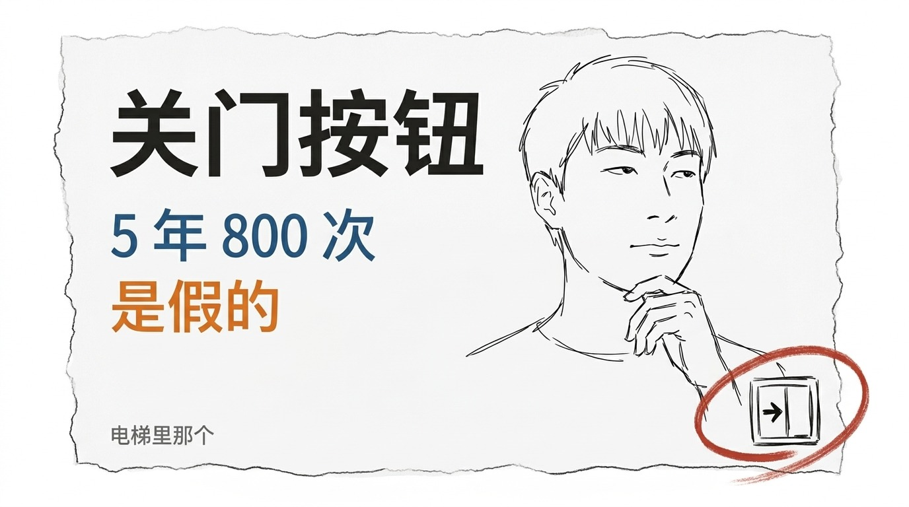
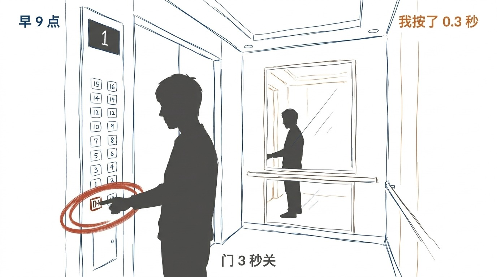
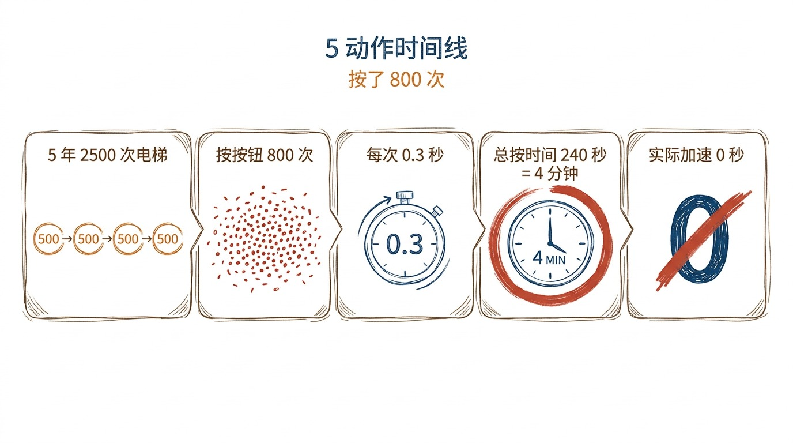
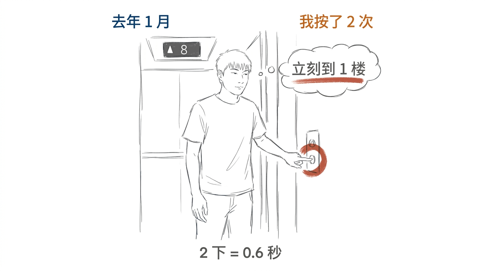

# 电梯里那个关门按钮, 我按了 5 年

## 5 年, 800 次

我坐了 5 年电梯。

每个工作日, 早 9 点 + 晚 6 点。 一年 250 个工作日, 每天 2 次, 一年 500 次。 5 年, 2500 次电梯。

其中, 大概有 1/3 的时候, 我会按 1 下关门按钮。 5 年按了 800 多次。

我以为按了, 门会更快关。

## 800 次按, 0.0 秒加速

昨天, 1 个朋友说: 你知道电梯那个关门按钮, 大部分都是假的吗?

我查了一下。 国内大部分商用电梯, 关门按钮都是装饰, 默认延时 3-5 秒, 按不按都一样。

800 多次按, 0.0 秒加速。

我坐了 5 年电梯。 按了 800 多次 1 个假按钮。

我没觉得被骗。 我只是觉得:

我按的不是关门, 是按的"我想快点"。

电梯里 5 秒。 没人催我。 但我想快点。 想快点到楼层。 想快点出去。 想快点回到我该在的地方。

## 按的不是关门, 是"我想快点"

5 年, 我按下 800 多次。 大部分时候, 我没注意。 0.3 秒按下去, 0 秒反应, 门 3 秒后自己关。 按钮跟我, 各干各的。

但有几次, 我记得很清楚。

800 多次。 大部分时候, 按钮是我跟自己说的话: "我想快点"。

我没跟任何人说。 800 多次按给"我想快点" 的我自己。

## 去年 1 月, 我按了 2 次

去年 1 月, 早上 9 点 02 分, 8 楼。 电梯里有 3 个人。 我赶 1 个会。 我按了关门按钮。 按了 2 次。 2 下加起来 0.6 秒。 门还是 3 秒关。

我按的 2 下, 不是我想要的"立刻关门"。 是我想要的"立刻到 1 楼"。

还有 1 次, 晚上 6 点, 16 楼。 1 个人进电梯, 站我前面, 不按楼层。 我想: "赶紧按了走"。 我按了关门按钮, 又按了 1 下我自己的楼层。 按钮让我觉得"事情在发生"。

## 现在不按了

后来我不再按了。

不是"知道了不用按"。 是"我开始接受 5 秒了"。

早上 9 点, 电梯里, 5 秒。 我站着。 门 3 秒后自动关。

我以前按的 0.3 秒, 现在变成 3 秒。 多 2.7 秒。

这 2.7 秒, 我以前用来按按钮。 现在站着。

站着, 比按着, 慢 2.7 秒。 但这 2.7 秒是"我的"。

电梯 5 年, 我按了 800 多次假按钮。

按的不是电梯, 是"我想快点"。

现在我不按了。

5 秒也是 1 个过程。

> 5 年按的不是按钮, 是"我想快点"。 现在不按了, 不是接受 5 年, 是接受 5 秒。

<!-- END-OF-POST -->

> **以下工具是草稿箱停点** (v2.8.32 sentinel). articles-to-wechat.py 检测到 `<!-- END-OF-POST -->` 后停止 body 解析, 配图说明 / 防重复池 / 待办 等内部文档**不会同步到草稿箱**, 移到 `doc/essays/images/032-elevator-close-button/README.md`. 跟 031 v2.8.29 修复后的格式 (5 段 ## + 5 张图 + 引用块) 一致.