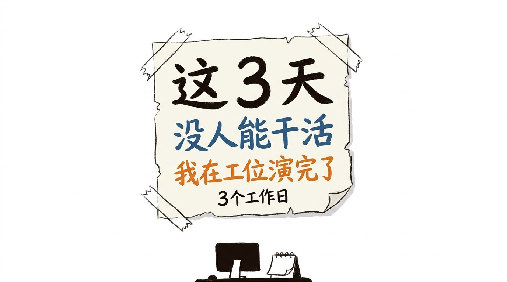
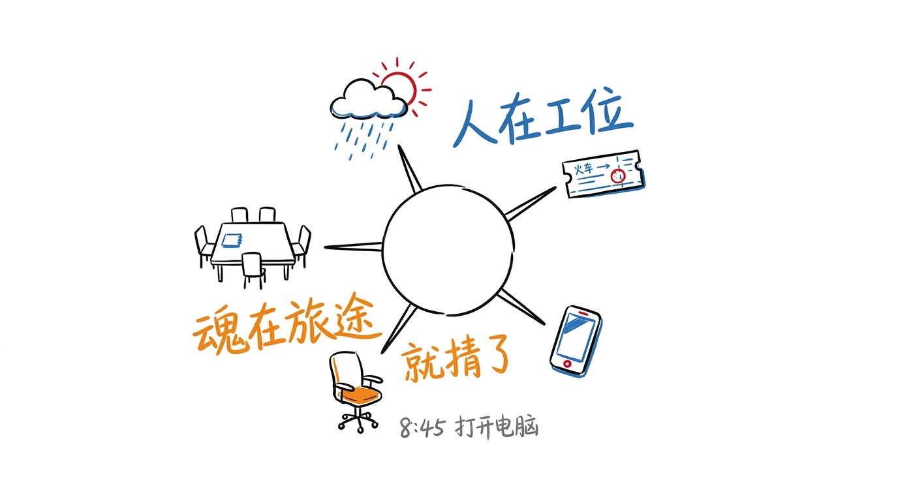
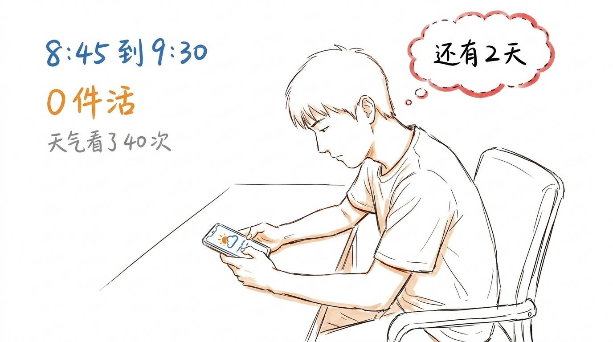
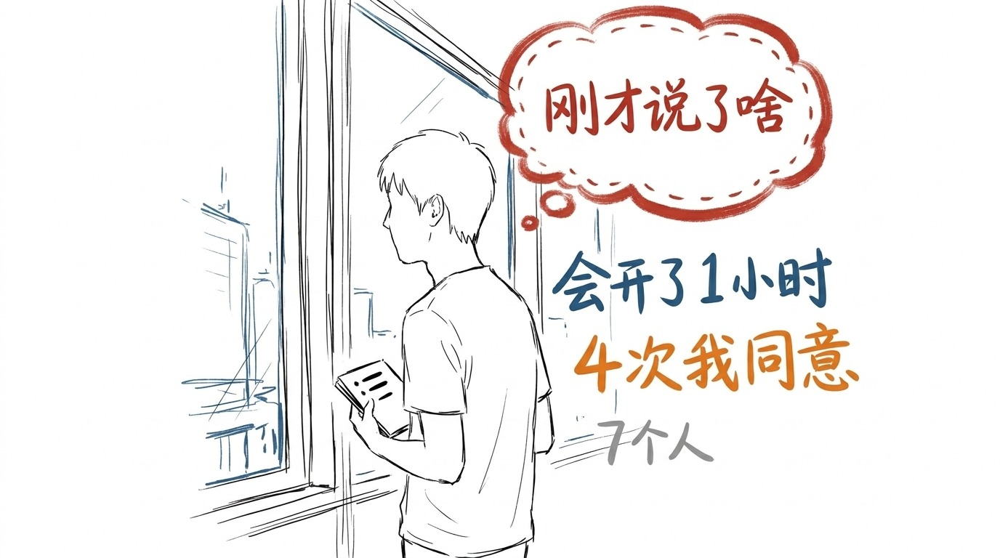
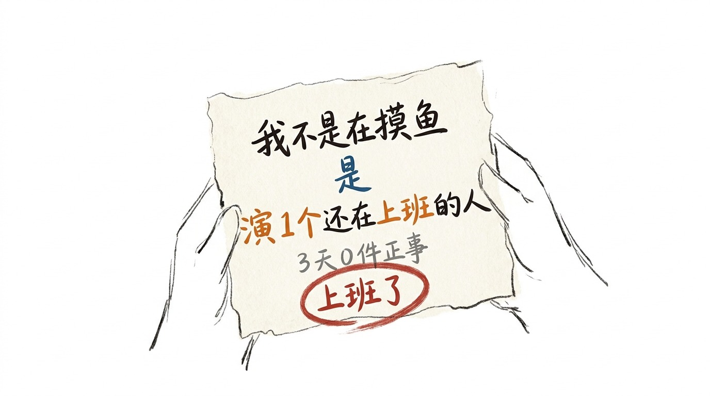

# 这 3 天没人能干活, 我在工位演完了

## 3 天, 5 种状态

9 月 28 到 30, 3 个工作日。

夹在两个假期中间。前面中秋, 后面国庆。

这 3 天, 我总结了 5 种状态。

1. 刷天气预报。 打开电脑第 1 件事, 不是打开工作文档, 是看杭州今天晴不晴。
2. 确认购票软件。 看了 4 遍车票, 4 遍都是"订单处理中"。
3. 围观朋友圈。 别人在晒行李箱, 晒高铁窗, 晒机场排队。
4. 开会记不住。 开 1 小时, 笔记本 3 行字, 全是"待定"。
5. 装在线。 人在工位, 魂在 500 公里外。

5 种状态, 3 天, 我全占了。

## 我不是摸鱼, 我是在演

以前我觉得这叫摸鱼。

摸鱼是不干正事, 心里有愧。

我心里没愧。

我只是在演"还在上班的人"。

打开电脑, 是演。 回消息, 是演。 开会点头, 是演。

演得很像。 我自己都快信了。

只是演到第三天, 我发现一件事:

演也是要力气的。

## 8:45 到 9:30, 0 件活

第一天早上 8:45, 我到工位。

9:30, 我打开工作文档, 往上翻, 找到昨天标红的那一行。

那行字我看了 3 遍。

然后我把文档关了。

不是不会做。 是那行字我看不懂, 但我得装成看得懂。

9:30 到 10:00, 我看了 40 次天气预报。

40 次里, 杭州 8 次晴, 12 次多云, 20 次没变。

我什么都没干。

但我也没走。

## 会开了 1 小时, 记不住

第二天上午 1 个会。

1 小时。 7 个人。

我笔记本上写了 3 行:

- 这个再看看
- 下周一给
- 待定

散会的时候, 我不知道这 1 小时讲了什么。

我只知道我说了 4 次"我同意"。

4 次"我同意", 1 小时, 7 个人。

没有人发现。

这可能才是最累的地方。

## 3 天演完了

第三天下午 4 点, 我把这 3 天的文档关了。

一件正事没干完。

3 天, 演了 3 天。

演的时候不累。 累的是演完了之后。

后来有人问我, 这 3 天你干了什么。

我说, 上班了。

他说, 你这 3 天不是都在刷手机吗。

我说, 刷手机也是上班。

他没有再问。

我也没有再解释。

3 天, 0 件正事, 5 种状态。

就这么记着吧。

> 这 3 天我不是摸鱼, 是演 1 个还在上班的人。 演完了, 3 天也没了。 我说, 上班了。

<!-- END-OF-POST -->
