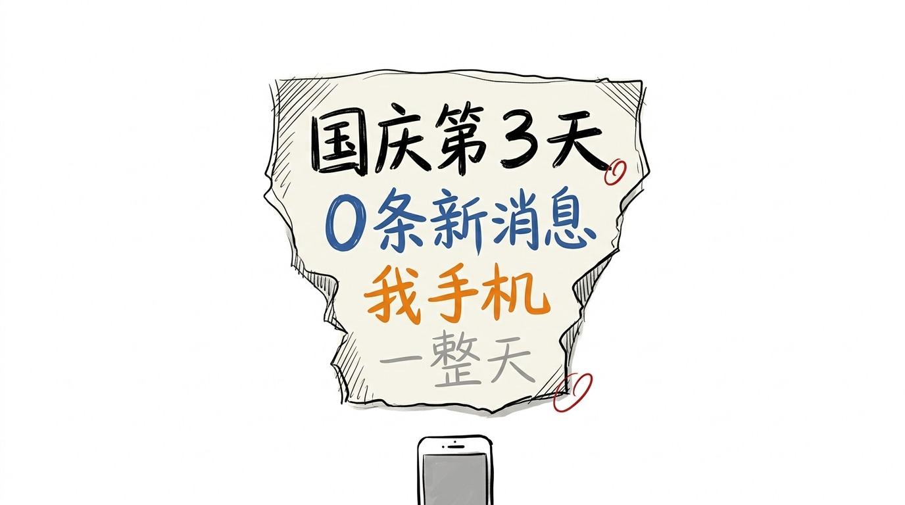
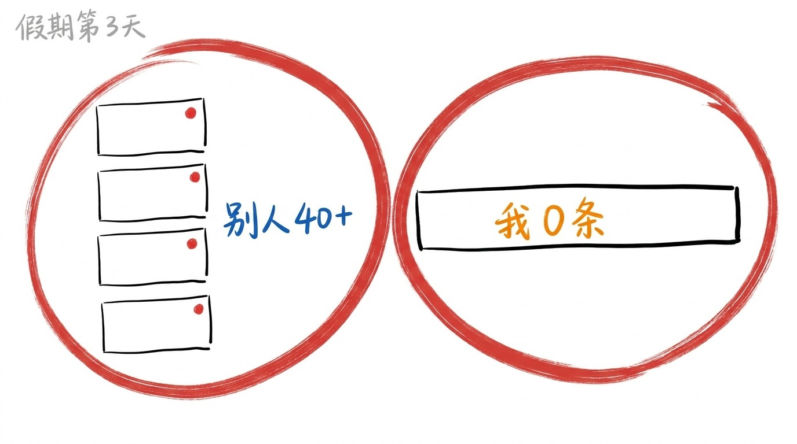
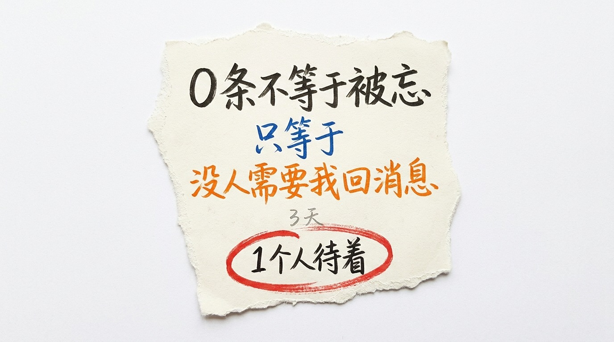

# 国庆第 3 天, 我手机 0 条新消息

## 假期第 3 天, 0 条

假期第 3 天。

我早上 8 点醒。 看手机。

0 条新消息。

中午 12 点。再看。0 条。

下午 3 点。再看。还是 0 条。

晚上 9 点。0 条。

1 天, 我看了 6 次手机。 0 条新消息。

不是没看。是看了以后, 什么都没有。

## 别人的假期, 都挺满

我有个同事, 9 号发了个朋友圈。 9 张图。 发的位置是某个山。

我点进去看。 下面 46 个赞。

我翻了翻自己的朋友圈。 上次发是 8 月 24 日。

有 3 个人, 每天在群里发旅游照片。 早上一张, 中午一张, 晚上一张。

我 1 天发 0 条。

不是我没地方发。

是没人问我。

## 我以前试过不被找

去年有一年, 我把 8 个群的提示音全关了。

理由听着很正当: 太吵。 一天响 200 次, 谁受得了。

关掉以后, 手机安静了。

前 3 天我觉得轻松。

第 4 天我发现, 我会一直看手机, 因为不知道会不会响。

看手机 = 等消息。

等消息 = 等 1 个人需要我。

去年那 1 年, 我没等到。

不是因为没人需要我。 是我把"被需要" 跟"响铃" 绑在一起了。

响铃是别人的事。 我把自己的事也挂在别人身上。

所以今年, 我把提示音打开了。

响就响。

## 我以为这叫失落

假期第 3 天, 我盯着那个空的屏幕, 想了很久。

我以前以为, 0 条新消息 = 我被忘了。

正常应该有 20-30 条。 家里群问"几号回来"。 老同学问"去哪玩"。 同事发个链接。

0 条, 意思大概是: 我不在别人的计划里。

想了大概 1 个小时。

后来我想明白一件事:

0 条不等于被忘。

0 条只等于: 3 天里, 没有 1 个人需要我回消息。

## 这不叫失落, 这叫 1 个人待着

9 月 28 到 30, 那 3 天我上班, 手机响个不停。

假期这 3 天, 0 条。

3 天里, 我没有 1 秒需要立刻回谁的消息。

没有"在吗"。 没有"什么时候回来"。 没有"帮我看下这个"。

我把这 3 天过成了: 睡到自然醒, 慢慢吃饭, 在家走了 1 万多步, 晚上 10 点睡。

7 天假期, 前 3 天我以为是失落。

后 4 天我知道了: 这是 1 个人待着。

1 个人待着不坏。

只是不太像假期。

假期应该是热闹的。 0 条消息, 是安静。

安静也不是坏事。

只是不太像, 别人过的那个假期。

> 假期第 3 天, 我手机 0 条新消息。 我以前以为这叫失落, 后来发现这叫 1 个人待着。 0 条不等于被忘, 只等于 3 天里没人需要我回消息。

<!-- END-OF-POST -->
