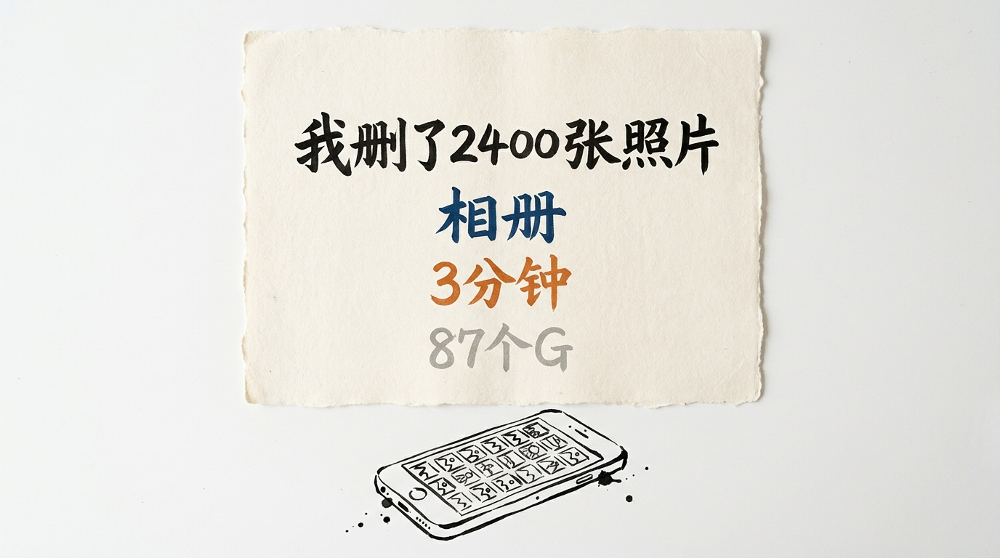

# 我删了 2400 张照片

晚上十点多, 手机弹了一条提示。

存储空间不足。

我点进去看。 照片占了 87 个 G。

顺手点清理。 系统给了一个数字。

可清理 2400 张。

我点了删除。

## 删得很快

三分钟。

2400 张, 三分钟。

大部分是截图。 一部分是拍完就没再打开过的。

我坐在床边等它跑完, 一张都没点开确认。

心里想的不是"删掉可惜"。

我想的是: 这 2400 张, 我一张都没打算看。

这个判断下得很快。 快到不需要过脑子。

## 最近删除里, 一张都没少

删完它告诉我。

已移入"最近删除", 保留 30 天。

我点进去。

2400 张整整齐齐躺在那儿, 按时间排好, 每一张都还能打开。

一张都没少。

这 30 天是个挺狠的机制。

它不真的删。 它只是让你相信你删了。

你看着 87 个 G 变少, 心里的那口气顺了。

照片还在原地, 完好无损。

只是换了一个你不会去点的文件夹。

**留着的不是照片。 是"以后可能会用"这个假设。**

## 2400 个假设

我算了一下。

2400 张, 每天 1 张, 是 6 年半。

按下删除的那 3 分钟里, 我一次性承认了 6 年半的"以后"。

这个承认很便宜。

便宜到有点假。

因为真正的成本不是那 87 个 G。

87 个 G 我不心疼。 反正照片迟早会满, 满了就清, 清完继续拍。

真正的成本是: 我原来一直觉得, 那些照片总有一天会用上。

用它做什么, 我不知道。

但"会用上"这三个字, 我信了很多年。

## 删的是"以后", 不是过去

照片这个东西有个特点。

它不需要理由就能留下来。

拍下来就在。 截图就在。 转发过来的也在。

它从来不问你要不要。

所以一个相册慢慢变胖的过程, 是不留痕迹的。

没有哪一天你会突然发现"我最近存了 2000 张"。

它是每天几十张, 安静地长出来的。

等到系统弹提示那天, 你才会第一次看见它。

这也是为什么那 3 分钟删得那么快。

因为这 2400 张照片, 我从来没有"存"过它们。

我只是没有删。

## 还有 29 天

今天是第 1 天。

在第 30 天到来之前, 我随时可以点恢复, 把 2400 张全捞回来。

我试了一下。

它会给一个很长的确认弹窗, 问你确不确定。

我看了两秒, 退出来了。

我知道我大概率不会去点它。

"我知道我不会"这件事, 是我今天唯一想清楚的。

---

> 照片就是照片。 我删掉的不是照片, 是"以后会用"这个假设。

你相册里有多少张, 是"留着以防万一"的?

<!-- END-OF-POST -->
