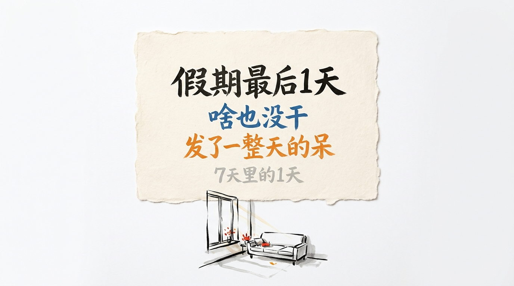
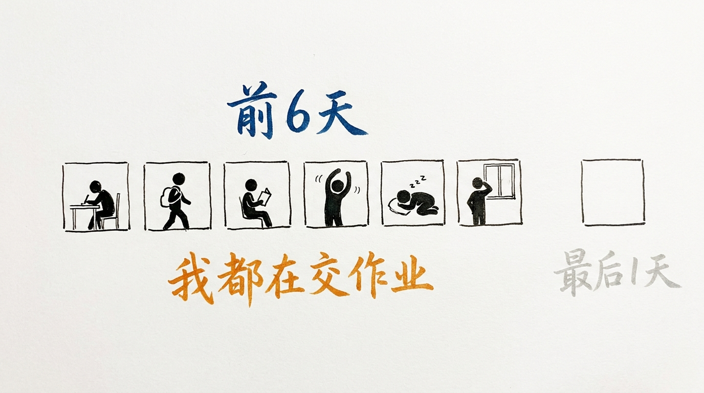
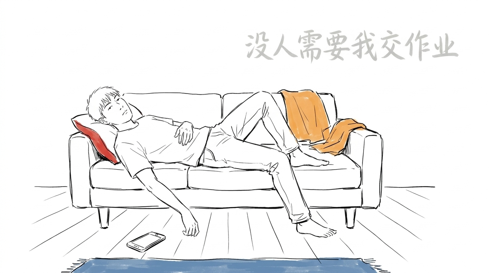
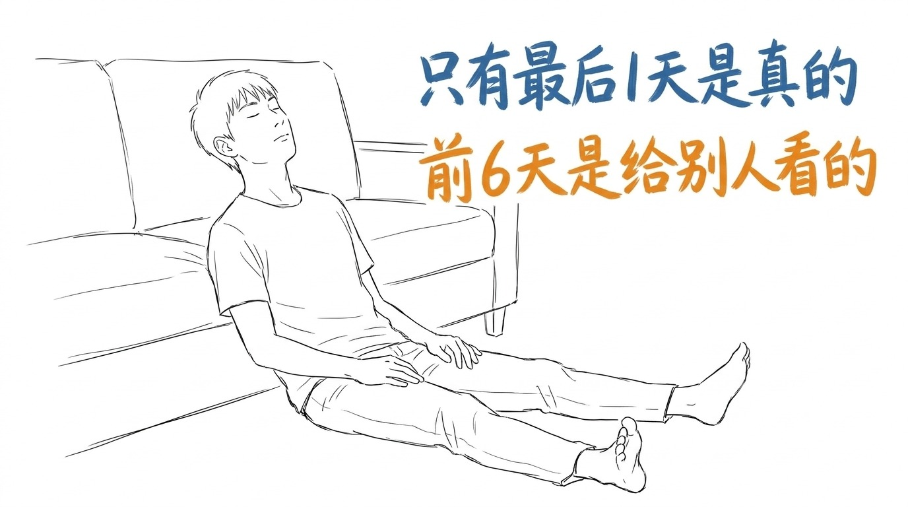
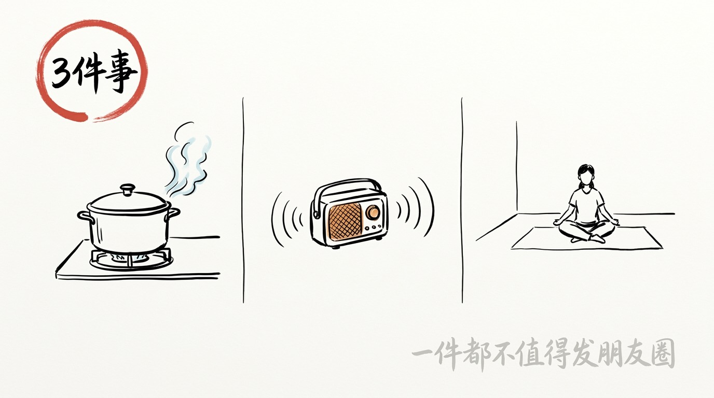

# 我假期最后 1 天, 啥也没干

假期最后 1 天。

我啥也没干。

没出门。 没见人。 没回消息。

没睡懒觉, 但也没做什么。

发了一整天的呆。

## 前 6 天我都在交作业

假期第 1 天, 我做了 9 件该做的事。

出门拍照。 出门吃饭。 出门走路。

每件事做完, 我都要确认一下: 这件事有人看吗。

第 2 天我学聪明了。 出门, 但不拍照。

第 3 天, 我连门都没出。

问题是我自己知道。

前 6 天里我至少有 4 次, 拿起手机不是为了看, 是为了发。

发之前我会想: 这条要配什么字。

想 3 分钟。 删掉。 再想 2 分钟。

然后不发了。

那 3 分钟我没在放假。 我在交作业。

前 6 天我一直在干"有事做"的事。

只有最后 1 天, 我在做"没事做"的事。

## 最后 1 天没人需要我交作业

前 6 天我一直在赶。

心里有个东西一直在说: 你今天拍了吗。 你今天出去了吗。 你今天看起来像在放假吗。

最后 1 天, 那个东西不响了。

因为没人需要我交作业。

老板放假了。 孩子放假了。 朋友圈里大家都在躺。

我躺得特别理直气壮。

**假期里只有最后 1 天是真的。 前 6 天都是给别人看的。**

## 我翻了 7 天, 发了 3 条朋友圈

假期过完, 我把 7 天翻了一遍。

里面全是景点照。 餐厅照。 路上的树。

我 7 天一共发了 3 条。

3 条里, 有 1 条是我儿子。

剩下 2 条, 我已经想不起来拍的是什么了。

看完我把那 2 条删了。

留着也没用。

它们不是拍给谁看的。 是我给自己交的两份作业。

## 那 1 天我干了 3 件事

说出来有点丢人。

我睡到中午。

我把冰箱里剩的东西煮了。

我坐在地上, 什么都不干, 听了 1 集 podcast。

3 件事, 一件都不值得发朋友圈。

但那 7 天里, 只有这 3 件事, 我现在还记得。

## 明年我打算改一件事

明年假期, 我打算把最后 1 天往前挪。

挪到第 2 天。

后面 5 天照样去干该干的。

但我要留 1 天, 从头到尾什么都不干。

那一天不是休息。

那一天是我这 7 天里唯一不需要证明自己在放假的一天。

这 7 天里, 有 6 天我在演一个正在放假的人。

只有 1 天, 我不用演。

我把那一天往前挪, 是想早点开始不演。

---

> 假期最后 1 天, 我啥也没干。 发了一整天的呆。 前 6 天我都在交作业, 最后 1 天没人需要我交作业。 假期里只有最后 1 天是真的, 前 6 天都是给别人看的。

你假期最后一天, 干了什么?

<!-- END-OF-POST -->
