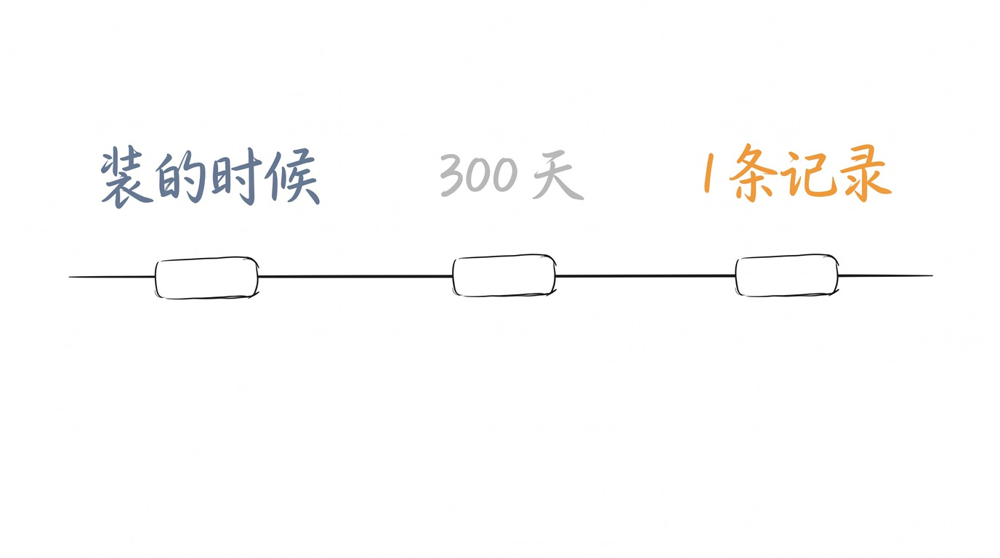
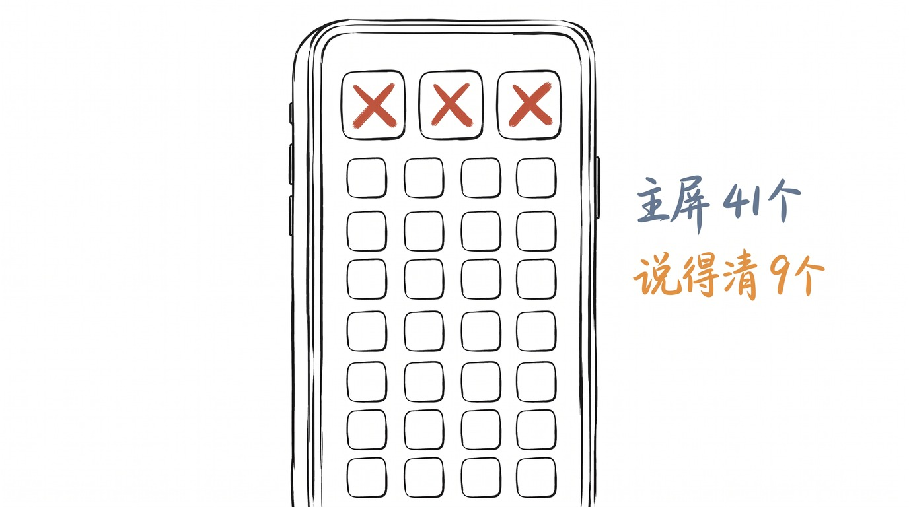
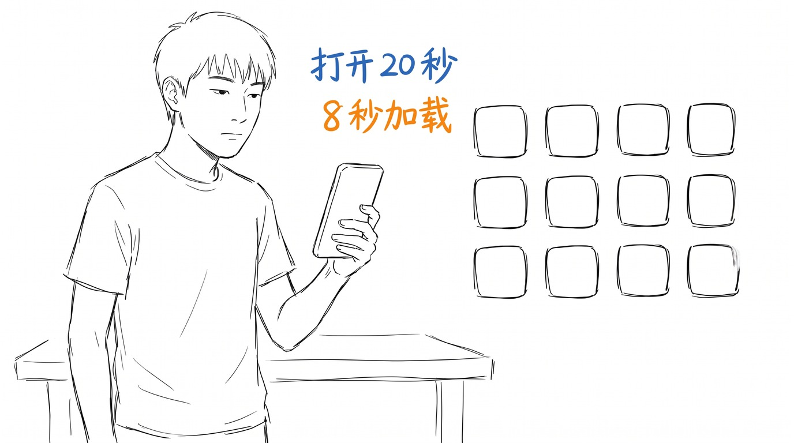
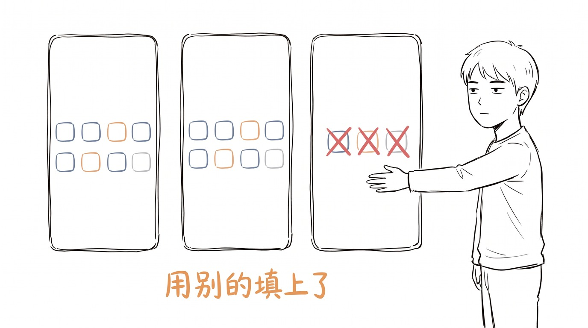

# 我删了手机里 3 个 App

周六早上, 我做了一件很小的事。

我把手机里 3 个 App 删了。

不是什么大决定。 就是删了。

删完那天,我打开手机找东西,少划了两屏。

## 3 个 App, 我一次都没打开过

第一个是记账的。

去年 12 月装的, 到现在 300 天。

第二次打开是今天上午,因为我忘了密码,去重置,登录,看了一眼记录。

上面只有一条。

去年 12 月 3 号, 记了一笔: 地铁 4 块。

之后 300 天, 一条都没有。

第二个是学外语的。

装的时候我说, 每天 10 分钟。

10 分钟没发生。

但它一直占着一个图标。

第三个我不说了。 我知道你们也有。

**删掉不难。 难的是承认这半年一次没打开过。**

## 我数了一下, 主屏上还有 41 个

删完 3 个, 我数了一下主屏。

41 个。

第一屏 24 个, 第二屏 17 个。

这里面, 我能立刻说出"我为什么装它"的, 大概 9 个。

剩下 32 个, 我不知道。

不是忘了。 是从来没认真想过。

## 我打开了一个, 看了 20 秒

我随便点了一个。

打开。

加载了 8 秒。

出来一个登录页。

我退出了。

整个过程 20 秒。

我不记得我为什么装它。

我也不记得它要我干什么。

但它确实在主屏第一行, 我每天至少看它 6 次。

一天 6 次。

一年 2000 多次。

**这 2000 多次, 没有一次是我真的要用它。**

## 删掉之后, 那天什么都没有变

这是最没意思的部分。

删完 3 个 App, 我那天的生活没有任何变化。

该上班上班, 该吃饭吃饭, 该刷手机刷手机。

少划了两屏, 但我划得更快了。

我以为删掉会有什么感觉。

比如轻松。

比如"终于清爽了"。

什么都没有。

就是主屏空出来 3 个位置。

我用别的 App 把它们填上了。

## 3 个月后我回来看

我说 3 个月。

现在做不到。

我只能说明天开始, 我每删一个就记一次。

删 3 个记 3 个。

删 10 个记 10 个。

不是要减重。

是想知道一件事:

**那些"反正也不占地方"的东西, 到底占的是什么。**

---

> 周六早上, 我删了手机里 3 个 App。 一个记账的, 一个学外语的, 一个我不说了。 打开第一个, 上面只有一条记录, 是去年 12 月的 4 块钱地铁。 主屏上还有 41 个, 我说得出为什么装的只有 9 个。 删掉之后那天什么都没变。 就是空出来 3 个位置, 我用别的填上了。

你现在手机里, 有几个 App 是想不起来为什么装的?

<!-- END-OF-POST -->
