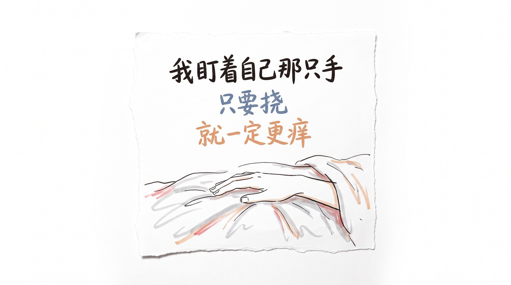
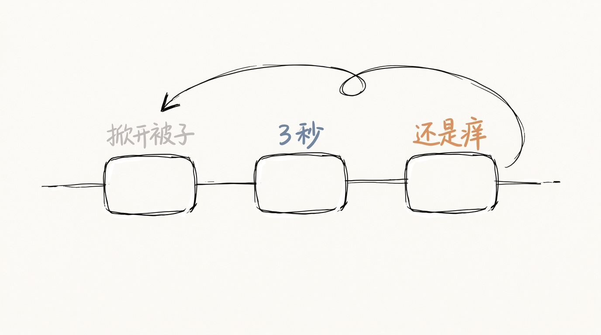
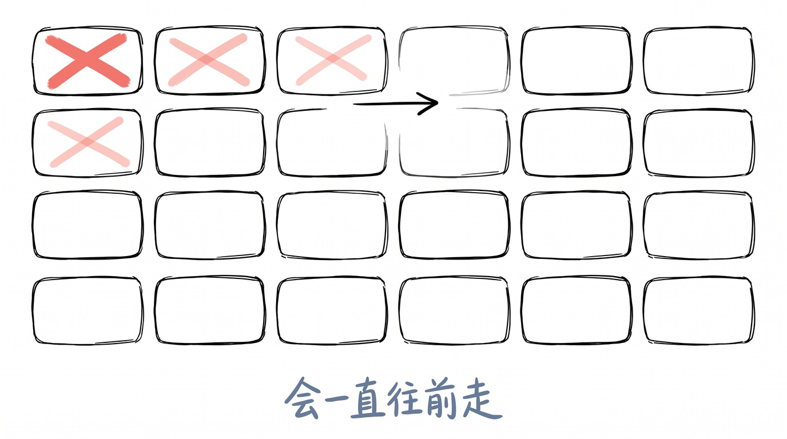
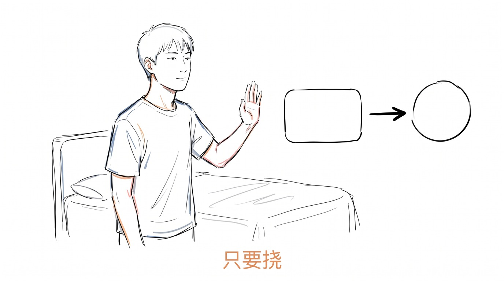
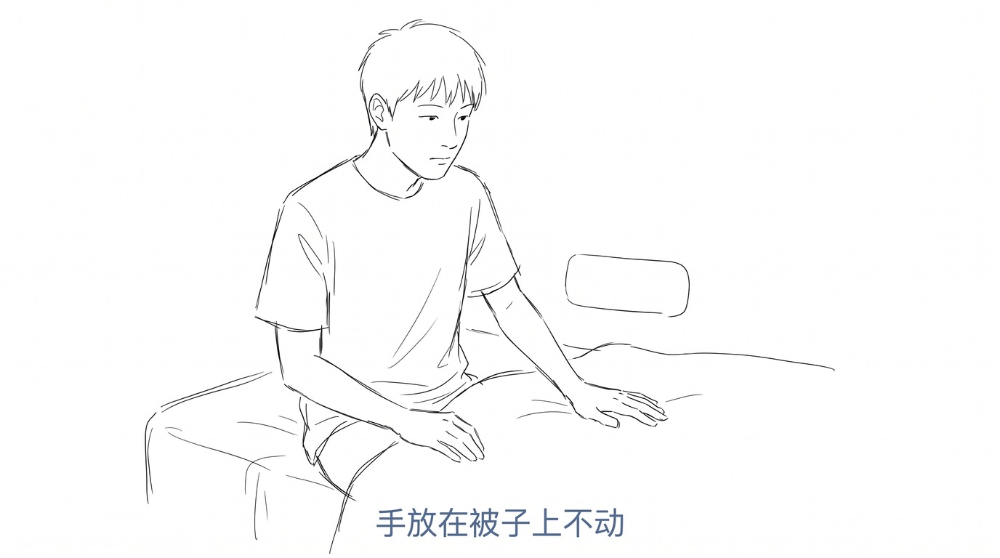

# 我盯着自己那只手

冬天的晚上, 被子刚掀开那 5 秒最痒。

胳膊肘那一块, 大腿外侧, 后腰。

我挠了。

爽了大概 3 秒。

然后我把被子盖回去, 还是痒。

## 同一个动作, 隔 3 秒是两种东西

我知道挠痒为什么会爽。

指甲划过皮肤, 会有一点点疼。

那一点点疼, 把痒盖住了。

不是治好了。 是盖住了。

疼的优先级比痒高。 它插了个队。

所以挠的那 3 秒, 不是不痒了, 是暂时轮不到它说话。

爽和痒, 来自同一个动作。

我盯着自己那只手, 看了很久。

它在挠的时候, 和挠完之后, 是同一只手。

## 越挠, 范围越大

我挠完那一块, 旁边开始痒。

再挠旁边, 又旁边。

不是皮肤在闹。 是挠这件事本身在扩散。

我查了一下为什么会这样。

指甲划破了皮肤最外面那层。 那层破了, 刺激就更容易进到里面去。

进到里面的东西, 会让那个地方更敏感。

于是同一个地方, 下一次更痒。

这个动作不会停在那里。 它会往前走。

我以前以为, 痒是一个地方的事。

现在觉得, 痒是一个过程的事。

## 它满足一个条件

网上有个词叫概念神。

定义很简单: 只要满足一个条件, 结果一定发生。

雨神萧敬腾, 只要开演唱会就下雨。

蛋神, 只要水开下蛋, 就 9 分 12 秒。

听起来都很远。

我挠痒也满足。

只要挠, 就一定更痒。

而且触发条件越简单, 结果越确定。

没有例外。 我试过很多次。

**挠痒是个概念神。 只要挠, 就一定更痒。**

我盯着那只手, 想到的不是它很厉害。

是它一直在执行。

我不动手, 它就不执行。

## 我现在怎么处理

我不治它。

痒这个东西, 没有人能治好。 它不生病, 它就在那儿。

我能做的只有一件事: 不给它机会。

现在痒的时候, 手放在被子上, 不动。

数到 30。

这 30 秒 里, 大概会淡一点。

**不是我拿下了它。 是我没有给它触发条件。**

这跟我理解的所有事情都不一样。

大部分事情我是去解决。 解决不了就烦。

痒这件事上, 唯一的办法是不参与。

## 3 个月后

我说 3 个月。

现在做不到。

我只能说明天开始, 每挠一次就记一次。

不是为了戒掉。

就是想看一眼, 我一天到底给了它几次机会。

---

> 冬天晚上被子刚掀开那 5 秒最痒。 挠的那 3 秒是疼把痒盖住了, 不是痒没了。 挠完旁边开始痒, 因为指甲划破了皮肤最外面那层, 刺激更容易进到里面去, 那个地方就变得更敏感。 网上有个词叫概念神, 只要满足一个条件, 结果一定发生。 挠痒也满足: 只要挠, 就一定更痒。 我现在不治它, 只是不给它触发条件。

你身上有没有一个地方, 是越挠越想挠的?

<!-- END-OF-POST -->