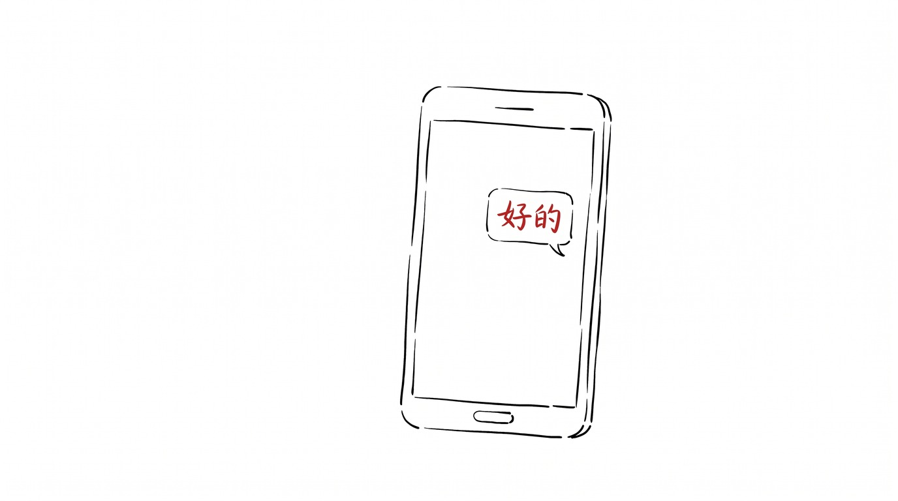
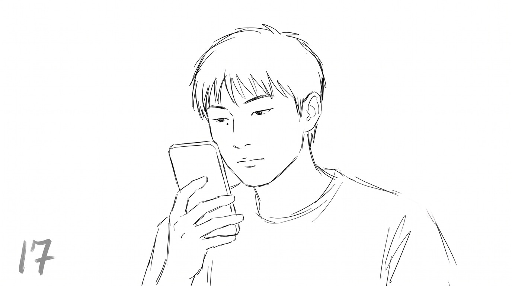
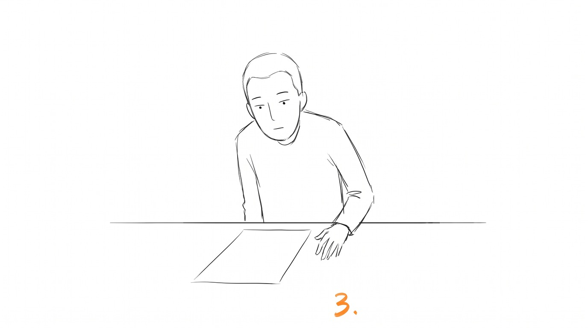

今天我回了 17 次"好的"。

我没有数错。不是随口说的, 我数过。

早上 8 点, 工作群发来一句"这个方案今天要", 我回了"好的"。
中午 12 点, 小区群发来一张停水通知, 我回了"好的"。
下午 4 点, 家长群老师问要不要报名, 我回了"好的"。
晚上 8 点, 家族群里我妹发来一张婴儿照, 我回了"好的"。

## 一天下来, 17 次里我认真读的只有 3 次

剩下 14 次, 我是凭肌肉记忆按下去的。

那个动作很轻。两下。"好"字还没打完, 已经发出去了。

有一次是挺好的。家长群那张报名表, 我点开看了三遍才回"好的", 后来孩子真报上了。

那 3 次我都记得。

## 那 14 次我是怎么按下去的

我试过留意一下。

工作群弹出来的时候, 我正好在切窗口。我甚至不确定上一次是谁在说话, 但手已经伸出去了。

"好的"。发出去。

然后我抬头看了一眼, 谁在说话来着?

这个动作在我身体里已经跑了十几年。快到不需要经过脑子。

后来我想了一下。

"好的"这两个字, 其实不需要我。

它不传递任何信息。对方不知道我看了, 不知道我懂了, 也不知道我会不会做。

那它为什么还要发?

因为它能让对话继续往前走。

**它的真实用途不是回答, 是让对方别停。**

我没有一次是因为没看见。

## 我也不是一直这样

工作上的事我会问清楚: "这个是要我今天做, 还是这周做?"
孩子的作业我会回: "哪一页? 我晚上看。"
朋友约饭我会问: "你几点到? 我可能晚十分钟。"

我不喜欢骗人。真的。

但大部分时候, 我不问。

因为问了, 就得负责。不问, 就不用。

我把"好的"当成了一个不用负责的按钮。

## 今天我又回了一次

下午我在群里看到一句话, 手已经点下去了。

点完之后我盯着屏幕看了两秒。

## 我在等什么

我在等有人追问我。

没人追。

对方收到了那两个字, 话题就往前走了, 没有人停下来问我到底看没看。

那 17 次里, 我一次都没有被追问过。

这不是别人不关心。这是我用 17 个"好的"提前买好了。

> 我不是懒得多问一句。
> 我是懒得承担那句问清楚之后, 就必须给出的那个答案。

**"好的"是我花出去的最便宜的东西。**

下次看到群里弹出一条消息, 手指放在屏幕上的时候, 你可以停一秒。

你回的那次, 是真的看了吗?

<!-- END-OF-POST -->
